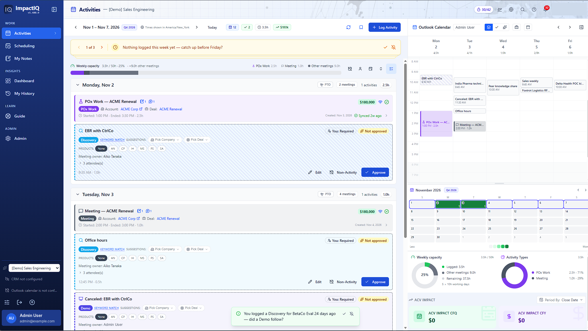
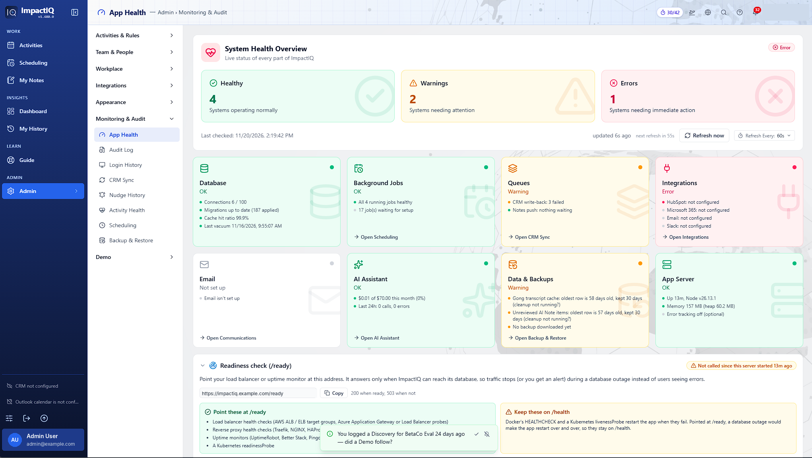
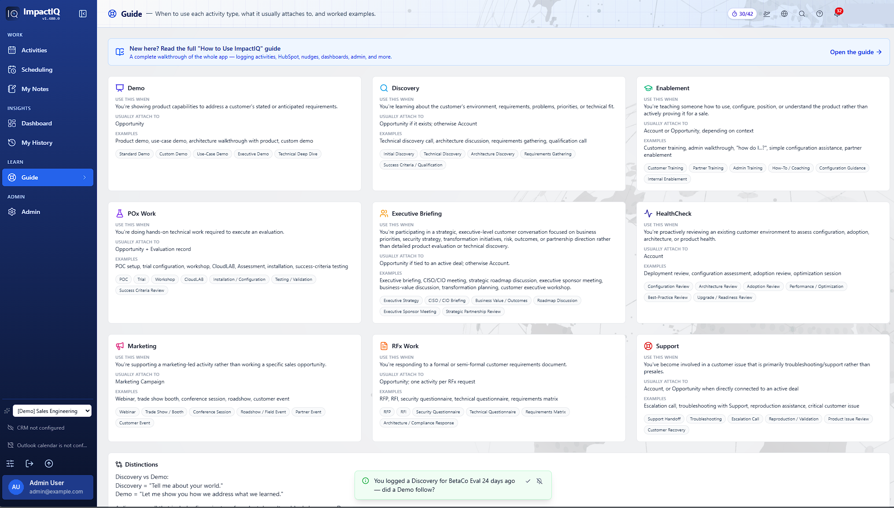
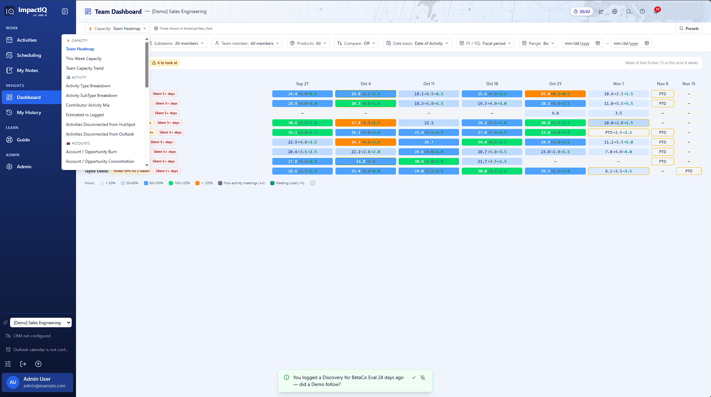
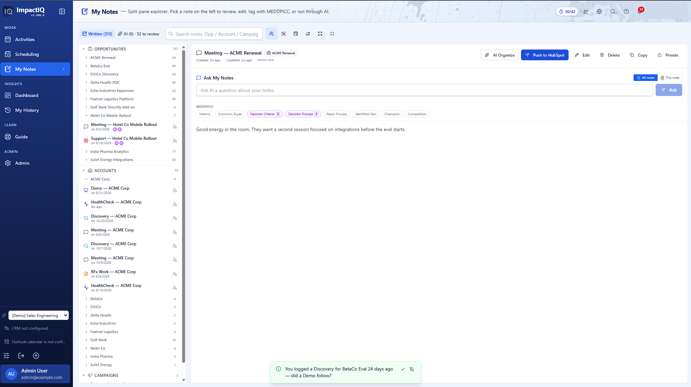

# ImpactIQ Value Narrative

> **Status:** in production · **License:** [Apache-2.0](LICENSE)
> Release notes for each version are in [`src/shared/changelog.ts`](src/shared/changelog.ts) and surfaced in-app via the version chip in the sidebar.
> PRD was originally written as a pre-development spec for the MVP; it has since been reconciled against what actually exists. It provides a roadmap to features and work coming related to token constraints. [`/PRD.md`](/PRD.md)

ImpactIQ is a revenue-capacity intelligence platform that connects technical and channel activity to your CRM (Salesforce or HubSpot, with a provider layer ready for more), creating a common view of resource consumption, opportunity coverage, utilization, and future capacity requirements.

Its business case should answer five leadership questions:
1. Where are SE and Channel resources spending their time?
2. Which opportunities, accounts, campaigns, and partners are consuming capacity?
3. Are the right opportunities receiving the right level of technical support?
4. Where will capacity constraints affect future revenue?
5. When should the organization rebalance resources, hire, or change coverage models?

## What it does

**Contributors** (SEs, Channel, Sales) log what they work on — demos, discoveries, evals, and more — linked directly to records in the install's CRM (Salesforce or HubSpot). Activities can be pre-filled from Outlook calendar events, saved as templates for one-click re-use, and imported in bulk from CSV. A hybrid intelligence engine suggests activity types via keyword rules with an AI provider as a fallback, and warns when a source calendar event is all-day, recurring, or multi-day (which would inflate capacity).

**Team Leaders** get read-only dashboards covering capacity, activity mix, account/opportunity burn, revenue (ACV vs SE hours), and a team-of-teams manager rollup.

**Admins** configure the system per team: the CRM (Salesforce, HubSpot, or none), activity types (with color/icon), CRM field mappings, picklist values, keyword rules, nudge rules, capacity groups, products, holiday calendars, hourly cost rates, integrations (Salesforce or HubSpot, Microsoft Graph, Okta, an AI provider, Slack, SMTP). Every admin action is written to an append-only audit log; login history + active sessions across all users are visible in the admin console.

## Screenshots

**Activities**: log the week's work from your calendar, with type suggestions, CRM links and capacity at a glance.



**App Health**: a live overview of the database, jobs, queues, integrations and backups for admins.



**Guide**: when to use each activity type, what it attaches to, and worked examples, set per team.



**Team Dashboard**: capacity heatmap by person and week, one of 20+ leader dashboards.



**My Notes**: every note grouped by Opportunity, Account and Campaign, with MEDDPICC tags and Ask My Notes.



## Feature Highlights

### CRM: Salesforce or HubSpot (v1.383+)
- **One CRM per install**, chosen on Setup step 6 or Admin → Integrations → CRM: Salesforce (default), HubSpot, or None. Once activities link to CRM records the install is locked to that CRM (switching to None and back is always allowed), since record ids don't carry across CRMs
- **HubSpot** (v1.389+) connects with one portal-wide service key or private app token (no OAuth, no env vars), runs an access check that lists each capability and the scope that grants it, and matches ImpactIQ users to HubSpot owners by email (overridable in User Management)
- On HubSpot: Deal/Company/Contact search (Leads and Campaigns when the portal has them), hover previews, meeting/task write-back with associations, nightly Deal snapshot refresh, notes push, Support Tickets, HubSpot Projects or custom objects as Projects, link health with automatic merge handling, Relink, attendee suggestions, Attach Rate, Sales Team Alignment, historical import and MCP tools
- **CRM-neutral everywhere** (v1.403+) — every on-screen "Salesforce"/"SF" follows the chosen CRM, CRM Field Mappings has a Salesforce / HubSpot toggle so the other CRM's mappings can be prepared ahead of a switch, and Activity Types extras, Team Management and User Management follow the CRM
- **Built for more CRMs** — all CRM work goes through a `CrmProvider` interface (`src/server/services/crm/`); adding a CRM means a new provider plus a display name, not edits across the app. See [docs/crm.md](docs/crm.md)

### Contributor (My Settings + Activities)
- Weekly activity log with Outlook calendar side-panel
- Auto-suggested activity types (keyword + GPT-4o)
- Meeting warnings: all-day / recurring / multi-day events
- Attendee-based Account/Opportunity (Company/Deal) suggestions via a CRM Contact lookup
- Activity templates + "New from template" quick-log + "Approve with template" one-click
- CSV backlog import (personal)
- Personal API keys for programmatic access
- Active Sessions ("sign out this device" / "sign out all others")
- Two-factor authentication (TOTP) required for password login — backup codes included
- Work-week + working hours; PTO days; holiday calendars
- **My History** (v1.214+) — read-only view of your own pre-ImpactIQ CRM activity (Salesforce Events or HubSpot meetings)
- **Inline CRM record preview** (v1.218+, Projects v1.222+, HubSpot v1.390+) — hover an Opportunity / Account / Project name on a card for current CRM state (stage, forecast, value, close date, owner, Assigned SE). Layers a live read over the local snapshot field-by-field, so it still works before you've connected your CRM
- **Attendee awareness** (v1.240+) — your own Required / Optional status from the Outlook invite shown on unapproved meeting cards and in the Log Activity drawer's Meeting responses summary, plus an All / Optional / Required filter on the day list
- **Tentative meetings** (v1.241+) — a subtle diagonal hatch on cards and calendar blocks when your RSVP is Tentative, tracking the live RSVP rather than freezing at approval
- **"No Match" instead of a guess** (v1.241+) — a meeting no keyword rule matched stays visible and approvable with a white No Match pill, instead of being silently assigned a type nobody configured
- **My Non-Activity Keywords** (v1.243+) — My Settings → Data & Templates. Comma-separated subject text that auto-marks matching meetings Non-Activity in *your* ImpactIQ only. Runs after your team's keyword rules and before the AI classifier
- **Deleted-meeting review** (v1.242+) — if an approved activity's Outlook meeting is deleted, it moves to a "This Week's Deleted Activities (Approved)" section with Keep (stays in ImpactIQ + Salesforce, badged "Not In Outlook") or Delete (removed everywhere, permanently)
- **Approved meetings are categorized in Outlook** (v1.244+) — approving an activity stamps the `ImpactIQ` category on the linked meeting, including meetings someone else organized (merged into your existing categories, never overwriting them). A companion **title sync** (v1.336+) does the same mailbox-local, merge-never-overwrite PATCH for a subject you edit on an existing meeting invite
- **Support Ticket attachment** (v1.337+, HubSpot Tickets v1.394+) — attach multiple CRM support tickets to an activity (any Activity Type an admin turns it on for), searched by default against the activity's linked Account with an Open Search toggle. Read-only link-out, ImpactIQ-only storage — never part of the CRM write-back
- **Marketing "Event Name"** (v1.334+) — optional free-text field on the Marketing activity type ("e.g. Innovate Security Summit, Black Hat"), ImpactIQ-only
- **Required-field markers** (v1.334+) — a red `*` on the Log/Edit Activity drawer's schema-required fields (and Products/Subtype when the picker is actually shown for your team), with Save/Submit blocked and an inline error until they're filled in
- **Activities Disconnected from SF** (v1.344+, HubSpot v1.399+) — a rose badge on any activity whose linked CRM What/Who/Related record has been deleted, detected by a nightly job plus a live check when you open the drawer
- **Pending deleted-Outlook-meeting indicators** (v1.363+) — a red dot on the month heatmap and a red day number on the week Outlook panel flag a day with an activity still awaiting Keep/Delete review, so the exception queue is visible without opening it
- **Markdown help icon** (v1.351+) — every notes field (Notes drawer, Log Activity's inline Notes, My Notes) has a click-to-open cheat-sheet popover showing bold/italic/headings/lists/links/code/blockquotes rendered live through the same Markdown pipeline a saved note uses, plus a tip that a single Enter is enough for a line break
- **In-app "How to Use ImpactIQ" guide** (v1.367+) — a full onboarding manual reachable from the Guide page's top banner, covering the whole app for every role: the weekly workflow, Salesforce linking, nudges/notifications, leader dashboards, admin orientation, My Settings, and an FAQ

### Leader Dashboards (10 groups, 20+ tabs)
- **Capacity**: team heatmap, this-week capacity, capacity trend
- **Activity**: activity breakdown, activity mix, plan vs actual, **activity subtype breakdown** (v1.267+, for teams with Subtypes enabled), **activities disconnected from SF** (v1.344+, every submitted activity whose linked What/Who/Related Salesforce record has been deleted, one row per activity with a link to the last-known record), **activities disconnected from Outlook** (v1.362+, read-only mirror for the other side: an approved activity whose Outlook meeting was deleted, still sitting in the owner's own Keep/Delete queue)
- **Accounts**: account/opportunity burn, concentration, **most expensive** (top-25 by cost of effort — Accounts / Opps / Campaigns / Leads toggle, with Account rollup)
- **Health**: logging compliance, logging lag, week-over-week delta
- **Products**: products breakdown
- **Revenue**: opportunity ROI (ACV × hours), cost-per-$-of-ACV
- **Manager**: team-of-teams rollup with 6 colored KPI cards, sales-team breakdown, **user leaderboard** (Total ACV / Closed ACV / Net Deal Margin / Efficiency Ratio), **team activity deep-dive** (v1.245+, single-team 3-tier tree with a subteam/user-first view toggle), **won without POC** (v1.268+, live SF read for Closed-Won Opps with no linked Evaluation), **closed lost — needs review** (v1.345+, Closed-Lost/Duplicate Opps that still have ImpactIQ activity, with a one-click Relink action that bulk-moves every activity to the real, live Opportunity and re-queues its Salesforce write-back)
- **Infrastructure**: project-specific costing (cost/hours/ACV by Project, Opportunity, Account, or Team/Subteam)
- **Coverage**: attach rate (pipeline coverage by rep, with SE-credit resolution for both User-lookup and picklist-shaped Salesforce fields)
- **History** (v1.214+): pre-ImpactIQ Salesforce activity — volume by year, top accounts, account coverage over time. Estimated hours only; excluded from all cost and capacity math
- **Global filters on Manager / Revenue / Accounts groups**: Sales Stage + Forecast Category multi-select chips (v1.137+), plus a manual "Refresh from Salesforce" button
- **"What changed" anomaly callouts** (v1.220+) on every tab — burn spikes, over-capacity contributors, people who stopped logging, activity-type swings, unlinked-activity spikes, SF write-back failures. Compares the last completed week against a fixed 8-week baseline (deliberately independent of the date filter), capped at 6 findings, and stays quiet when history is too thin to judge

### Admin
- Team CRUD (hard delete supported for dev/reset)
- Activity types with color + icon
- **CRM** (v1.384+): choose Salesforce, HubSpot or None on Admin → Integrations → CRM; per-CRM connection cards (Salesforce Connected App + admin connection; HubSpot key, access check, owner sync); **CRM features** switches for Campaigns and Leads (v1.381+, also hidden automatically when a HubSpot portal lacks them); **Projects (POC|POV)** source: CRM object, CriteriaIQ, or Off (v1.385+)
- **CRM Field Mappings** (renamed from SF Field Mappings, v1.404+): app field → CRM field per team, with a Salesforce / HubSpot toggle and live HubSpot property pickers; Export / Import as JSON
  - v1.138+: per-mapping **Background refresh (nightly)** and **Refresh only for reports (no writeback)** flags — nightly `refresh_opp_snapshots` job pulls flagged fields from SF and snapshots them onto activity rows for dashboards
- Keyword rules — including **Non-Activity** as a target, so a team rule can auto-exclude recurring meetings (v1.240+); an info banner states what happens to a meeting no rule matches
- Activity types — per-team **Default suggestion** star pill (v1.240+) that drives the "nothing matched" fallback; without one, unmatched meetings stay untyped rather than being guessed at
- Nudge rules (assignable per team, with Slack + Email delivery per rule) — each rule has an admin-editable **Name** (v1.324+) so rules sharing the same trigger type can be told apart in the rule list, Nudge History, and audit logs
- **CRM field mapping Validate & dry run** (v1.219+, HubSpot v1.391+) — static checks (duplicate/dead mappings, read-only flags on fields write-back needs), org describe checks (field exists, createable, type fits, picklist membership), and the real `buildSfRecord()` run against your most recent submitted activity so you see the exact payload a sync would send (a HubSpot meeting/task on HubSpot). Always returns 200 — a CRM outage degrades to static-only rather than blanking the page
- Capacity groups (fixed / self-declared / exception-adjusted / **calendar-derived** — v1.225+, target auto-computed from members' trailing 8-week real meeting load), plus an admin-gated per-group "Meeting Load" figure on leader dashboards
- Cost groups (per-user hourly cost, drives the $ KPIs)
- Products (team-linked, activity-linked)
- Fiscal year + holiday calendars (team-assignable)
- Integrations: Okta OIDC, Salesforce or HubSpot, CriteriaIQ, Microsoft Graph (Outlook), AI Assistant (Anthropic, Azure OpenAI, OpenAI, Amazon Bedrock, Microsoft Foundry, Google Gemini, xAI), SMTP/Graph email, Slack per-team bot
- **App Updates** (v1.332+, App Admin) — a self-fetching card checking a pinned GitHub branch for a newer `CHANGELOG[0].version` than what's running, with a changed-lines preview. **Scheduled maintenance window** (v1.333+) — the default admin schedules a restart (or fires one ~15s out via **Restart Now**, v1.336+); every signed-in user sees an advance-notice banner that becomes a non-dismissible 30-minute countdown, then the app exits its own process and the container's restart policy brings it back up. Deliberately host-independent and **not** an auto-redeploy — it puts a newer version live only if an admin already staged a rebuilt image out-of-band
- **Themes** (architecture finalized v1.347+) — every color/logo/email-header combination is a real, assignable row (`app_themes`); the app always has ≥1 theme and exactly one Active one, enforced server-side. Any team can be assigned any theme; a team with none inherits the Active one, which is also what an unauthenticated Login page visitor sees. **13 built-in presets** (v1.357+, v1.365+) including a hue-neutral Gray and a Dark X quartet (Purple/Blue/Yellow/Green). A single **unified color picker** (v1.361+) — swatch + hex + gradient popover, plus a screen `EyeDropper` button on supporting browsers — now backs every color field in the app, replacing the last native `<input type="color">` holdouts
- **Setup wizard** — step 6 chooses the CRM (Salesforce with its Connected App details, HubSpot connected afterwards from Admin → Integrations, or None); shares the same branded gradient + world-map background as Login/ForgotPassword (v1.352+), enforces the same full password-complexity policy on the initial admin account as every other password-write path (v1.353+), and no longer mentions Dokploy by name (v1.352+)
- Role Management: per-role page-access matrix (Dashboard tabs + admin sections)
- **Monitoring** (App Admin): **App Health** (v1.146+: live DB size, per-table row/size/scan stats with missing-index flags, slowest queries, connections, uptime/memory — default section on opening Admin) · Audit Log · Login History · Sync Issues · Sync History (tenant-wide SF write-back attempts) · **Nudge History** (v1.324+: team-scoped like every other Nudge Rules screen — App Admins can still switch to All Teams for the old tenant-wide view — with a History/Dismissals tab switcher and a 4-KPI row: Top Nudge, Top User, Most Snoozed Nudge, Top Snoozing User) · **Scheduling** (v1.138+: read-only status table for every registered background job, per-job "Email admins on error" toggle deduped to one email per job per day, with a **Run now** button per job — v1.283+). Admin submenu categories are collapsible; Monitoring & Audit is expanded by default. Login History, Audit Log, and Scheduling each carry a 5-stat KPI row (v1.330+)
- **Workplace**: **Flight Deck** (v1.249+) — a team-configurable login onboarding checklist shown in a post-login welcome modal, reopenable anytime from the header. **Announcements** (v1.349+) — team broadcast messages targeted at a team, a subteam, or one person, shown in the header banner and notification bell until dismissed, with an optional custom icon and light/dark color
- User management with MFA-required onboarding. **Connections column** (v1.348+) shows live-vs-stale Salesforce/Outlook status per user with an admin-triggered **Verify** probe
- Bulk CSV activity import (by team, with `user_email` column for team-wide imports)
- Slack bot user sync via `users.lookupByEmail`
- **Single-button SSO login** (v1.346+) — one "Sign in with Identity Provider" button when only one of Okta/Azure is configured; a small inline picker (with a "remember my choice" option) when both are

### MCP server (v1.145+)
- Read-only [MCP (Model Context Protocol)](https://modelcontextprotocol.io) endpoint at `POST /api/mcp` for LLM agents (Claude Desktop, Claude Code, Cursor, **n8n MCP Client Tool**, Cowork)
- Scoped API tokens: `mcp:read` tokens can only call MCP tools; `rest:full` tokens can only call REST endpoints
- Admin → Integrations → MCP Server for the on/off kill switch + copy-paste config snippets — n8n, Claude Desktop, and (v1.350+) **claude.ai web (Connectors)**, with a documented caveat that its dialog has no field for a Bearer token so a `mcp:read` key can't be reliably connected through it today — plus the MCP activity KPIs + audit log of every tool call (retained 30 days) with per-token stats + revoke (the former standalone "MCP Activity" monitoring page was merged in here in v1.146)
- Per-token rate limits (60/min, 1000/hr) + tenant daily cap (5000/day), env-configurable
- Full docs: [docs/mcp.md](docs/mcp.md)

## Tech Stack

| Layer | Technology |
|---|---|
| Frontend | React 19, Vite, Tailwind CSS 4, shadcn/ui |
| Backend | Express 5, TypeScript 6 |
| Database | PostgreSQL, Drizzle ORM |
| Auth | Okta OIDC (PKCE + JWKS) or local email/password + TOTP MFA |
| CRM | Salesforce (JSForce v3, per-user OAuth 2.0) or HubSpot (CRM v3/v4 REST APIs, portal-wide service key / private app token), behind a `CrmProvider` interface |
| Calendar | Microsoft Graph API v1.0 (Outlook), delegated + optional app-only |
| Slack | Web API (bot token, `users.lookupByEmail` + `chat.postMessage`) |
| AI | Admin's choice of Anthropic, Azure OpenAI, OpenAI, Amazon Bedrock, Microsoft Foundry, Google Gemini or xAI |
| Email | Microsoft Graph `sendMail` (app-only) OR SMTP |
| i18n | react-i18next (en, de, fr, es, ja, pt, it) |
| Deployment | Docker + Dokploy |

## Security Posture

Highlights from the audit-driven hardening pass:

- **MFA required** for every password login (TOTP RFC 6238 + backup codes). Okta/Azure SSO users continue to rely on IdP-level MFA.
- **Password reuse + 90-day expiry policy** *(v1.323+)* — scoped to password-only accounts (Okta/Azure SSO and "All Login Options" accounts are exempt, since the expiry gate would also block their SSO login). Rejects a new password matching the current hash or any of the last 4 rows in `password_history`; a daily job flags any password-only account past 90 days via the same forced-change flow first login already uses.
- **Server-side session table** with active-sessions listing + force-revoke; legacy HMAC cookies upgrade to server-side rows on next request.
- **PKCE + JWKS** for Okta id_token verification; `email_verified` gate on JIT provisioning (admin can opt-out per deployment). The PKCE verifier + OIDC nonce cookie itself is AES-256-GCM encrypted (v1.256.1), not just signed.
- **Azure/Entra SSO** as a fourth, mutually-exclusive Sign-in Method choice alongside Okta-only, password-only, and "All Login Options" *(v1.323+)*.
- **CSRF** double-submit cookie on every non-GET.
- **Login rate limiting** — 10 attempts / 15 min per IP, **plus a per-account (email) ceiling** *(v1.289+)* so a distributed attacker spread across many IPs can't bypass the per-IP limit on one known account.
- **Security headers** on every response: CSP, HSTS (prod), X-Frame-Options, X-Content-Type-Options, Referrer-Policy, Permissions-Policy.
- **Postgres TLS** in production — opportunistic by default (encrypts when the server offers it, connects plain otherwise; never a hard failure just because the target Postgres doesn't support TLS), with `DATABASE_SSL_REQUIRE=true` or `DATABASE_SSL_CA` available for strict, verified TLS against a genuinely public/external Postgres.
- **SSRF guards** on setup wizard + admin config-save/`test-*` endpoints (Salesforce, Azure OpenAI, Okta), the real Azure OpenAI classification call, and the per-team Slack webhook sender — refuses non-HTTPS, RFC1918, loopback, link-local, and cloud-metadata addresses, plus a `*.salesforce.com`/`*.force.com` and `*.openai.azure.com` host allowlist (with an admin-configurable custom-domain exception for Azure OpenAI Private Link) for the two endpoints that route a real secret through the request *(pentest 2026-09, F-01/F-02)*. The HubSpot client only ever calls `https://api.hubapi.com` (callers pass a path, never a host, and redirects aren't followed), and the CriteriaIQ base URL goes through the same guard with an explicit private-network opt-in.
- **Safe SOQL escape** (backslash-first, `safeSoqlLiteral()`) across all Salesforce searches — two CodeQL `js/incomplete-sanitization` findings (ticket search *v1.342.1*, Opportunity Relink *v1.349.6*) were fixed by wiring the missed call site up to the same shared helper, not a one-off patch.
- **Dedicated rate limiters** *(v1.327+)* on the Okta/Azure OIDC callbacks (30/15min per IP) and router-wide on `salesforce.ts` (60/min per user) and `history.ts` (30/min per user), on top of the app-wide session limiter.
- **Suspicious login alerts** — email on first login from a new IP, with token substitution HTML-escaped by default *(v1.289+)* so a client-controlled value (e.g. User-Agent) can't inject markup into the notification.
- **Fail-loud env validation** — production refuses to start without `SESSION_SECRET` and `TOKEN_ENCRYPTION_KEY` set to 32+ chars.
- **Pentest remediation (Sept 2026)** *(v1.356+)* — an external manual pentest reported 2 High (self-escalation to App Admin via the role-set endpoints; an IDOR pattern missing a team-ownership check on a nested resource, found and fixed on ~23 routes after the audit) and 2 Medium (SSRF via the Salesforce `loginUrl`/Azure OpenAI `endpoint` admin config fields) findings, plus one Informational (unvalidated Flight Deck link/screenshot values). All fixed the same pass.
- **Cross-team data scoping audit** *(v1.288–v1.289)* — a full RBAC/data-scoping pass found and fixed five cross-team leaks (MCP server tools had no team/user scoping at all; any Contributor could self-issue an `mcp:read` key; History dashboards and `/admin/users`/`/admin/teams` trusted a client-supplied team without checking membership) plus five lower-severity findings (stack-trace disclosure on one dashboard, unaudited SF Field Mapping changes, a theme-logo upload MIME gap).
- **Audit log** on team/user/permission/integration mutations, including SF Field Mapping create/update/delete with a before/after diff *(v1.289+)*.
- Encrypted at rest: SF/MS refresh tokens, the HubSpot key, CriteriaIQ and AI provider keys, Okta/Azure OAuth state cookies, TOTP secrets, Slack bot tokens (AES-256-GCM).

## Getting Started

### Prerequisites

- Docker and Docker Compose
- Node.js 22.9+ (for local dev without Docker — needed for `--env-file-if-exists`, which the dev server uses to load `.env`)
- Access credentials for Okta (optional), your CRM (a Salesforce Connected App, or a HubSpot service key / private app token), Microsoft Graph, an AI provider (optional), Slack (optional)

### 1. Clone and configure

```bash
git clone https://github.com/egarlepp/impactiq.git
cd impactiq
cp .env.example .env
```

Fill in the three required secrets in `.env`, then add any integration credentials (see [Environment Variables](#environment-variables) below):

```bash
# Paste each value into .env
openssl rand -hex 24   # POSTGRES_PASSWORD
openssl rand -hex 32   # SESSION_SECRET
openssl rand -hex 32   # TOKEN_ENCRYPTION_KEY
```

Docker Compose refuses to start without `POSTGRES_PASSWORD`, and in production the app refuses to start while `SESSION_SECRET` or `TOKEN_ENCRYPTION_KEY` still holds the `change-me` placeholder from `.env.example`. The bundled Postgres listens on `127.0.0.1:5432` only, never on a public interface.

### 2. Run with Docker (recommended)

```bash
docker compose up -d
```

Migrations apply automatically on server boot. The app is available at `http://localhost:3000`. With `DATABASE_URL` unset, the first visit opens `/setup`, a guided wizard for the database, the first admin and integrations. With `DATABASE_URL` already set (Docker Compose), the server prints a setup token to its log while no account exists, and the sign-in page shows **Create the first admin**: enter that token (or the value of `SETUP_TOKEN`) with the admin's name, email and password.

### 3. Run locally (development)

```bash
# Start Postgres (needs POSTGRES_PASSWORD in .env)
docker compose up postgres -d
# Then set DATABASE_URL in .env to
# postgresql://impactiq:<POSTGRES_PASSWORD>@localhost:5432/impactiq

# Install dependencies
npm install

# Start dev servers (client + server concurrently)
npm run dev
```

Client runs on `http://localhost:5173`, server on `http://localhost:3000` (proxied).

## Environment Variables

Copy `.env.example` to `.env`. In **production** the app refuses to start unless `SESSION_SECRET` and `TOKEN_ENCRYPTION_KEY` are both set to at least 32 chars and neither is the `change-me` placeholder.

```env
# App
NODE_ENV=production
PORT=3000
APP_URL=https://impactiq.internal.example.com

# Database
DATABASE_URL=postgresql://impactiq:<POSTGRES_PASSWORD>@postgres:5432/impactiq
# Optional: for strict TLS to an external Postgres with a private CA
# DATABASE_SSL_CA=/etc/ssl/certs/postgres-ca.pem
# Optional: force strict TLS (verified against Node's trusted CA bundle)
# instead of production's opportunistic-by-default TLS. Ignored if
# DATABASE_SSL_CA is set.
# DATABASE_SSL_REQUIRE=true

# Security-critical secrets (REQUIRED in production; 32+ chars)
SESSION_SECRET=<generate: openssl rand -hex 32>
TOKEN_ENCRYPTION_KEY=<generate: openssl rand -hex 32>

# Okta OIDC (optional — password login always available)
OKTA_DOMAIN=your-domain.okta.com
OKTA_CLIENT_ID=your-client-id
OKTA_CLIENT_SECRET=your-client-secret
OKTA_REDIRECT_URI=https://impactiq.example.com/auth/callback

# Salesforce Connected App (only when Salesforce is the CRM)
# HubSpot has no env vars: paste its key in Admin → Integrations → HubSpot
SF_CLIENT_ID=your-sf-client-id
SF_CLIENT_SECRET=your-sf-client-secret
SF_REDIRECT_URI=https://impactiq.example.com/auth/salesforce/callback
# SF_LOGIN_URL=https://test.salesforce.com  # uncomment for sandboxes

# Microsoft Graph (Azure App Registration)
MS_CLIENT_ID=your-azure-client-id
MS_CLIENT_SECRET=your-azure-client-secret
MS_TENANT_ID=your-azure-tenant-id

# AI providers are set up in the app: Admin → Integrations → AI Assistant

# Performance / observability (all optional — defaults shown)
DB_POOL_MAX=10                    # max Postgres pool connections
DB_STATEMENT_TIMEOUT_MS=30000     # per-query statement_timeout (ms)
# DB_IDLE_TIMEOUT_S=              # idle client timeout (s)
# DB_CONNECT_TIMEOUT_S=          # connection acquire timeout (s)
# DB_QUERY_LOG=1                 # echo SQL to logs
SLOW_REQUEST_MS=1500              # log HTTP requests slower than this
# REQUEST_TIMING_LOG=1           # log timing for every request
DASH_MAX_WINDOW_DAYS=1095         # cap "All time" dashboard ranges (~3 years)

# Retention culls (run in the 6h housekeeping sweep)
AUDIT_EVENTS_RETENTION_DAYS=1095
JOB_RUNS_RETENTION_DAYS=90
ATTACH_RATE_HISTORY_RETENTION_DAYS=1095
# ACTIVITIES_ARCHIVE_DAYS=       # off by default; soft-archive only (is_archived=true), never hard-deletes
```

Most integrations can also be configured **through the admin UI** (Admin → Integrations); env vars are the fallback / bootstrap path. Slack, HubSpot, the CRM choice and CRM features, Outlook forward-window/retention, SF internal-domain filter, and Okta email-verified override live only in the admin UI (they persist to the `system_settings` table).

## RBAC

Four roles, enforced server-side on every endpoint, scoped per team:

| Role | Access |
|---|---|
| **Contributor** | Log/view own activities; read-only view of team's submitted activities; personal Settings (templates, API keys, MFA, sessions) |
| **Team Leader** | Read-only leader dashboards for their team(s) |
| **Team Admin** | Everything a leader can see + manage team-scoped rules, users, picklists, activity types, capacity, bulk CSV import for their team |
| **App Admin** | Full access: cross-team config, integrations, role permissions, audit log, login history, all-team import |

A user can hold different roles on different teams. Roles are never trusted from the client. The specific pages a role can see are configurable per deployment via **Admin → Role Management** (page-key access matrix).

## CRM Integration

ImpactIQ talks to **one CRM per install**: Salesforce (default), HubSpot, or none. Full setup,
scopes, feature matrix, limits and the guide for adding another CRM are in
**[docs/crm.md](docs/crm.md)**. In short:

- **Choose** on Setup step 6 or Admin → Integrations → CRM. Either CRM can be chosen before its
  connection is saved (an amber warning says so). Once CRM-linked data exists, the install can
  only move between that data's CRM and None.
- **Provider layer** — routes, MCP tools, the activity save path, notes push and the dashboard
  Refresh button all go through `getActiveCrmProvider()` (`src/server/services/crm/`). CRM-only
  routes and jobs are guarded so they stand down when their CRM isn't active.
- **Data model** — tables, columns and enum types that hold data for any CRM are named `crm_*`
  (`crm_what_id`, `crm_record_id`, `crm_field_mappings`, `crm_users`, …) and hold whichever CRM's
  ids the install uses; Salesforce-only tables keep `sf_*`.
- **Wording** — UI strings use `{{crm}}` / `{{crmShort}}` i18next variables, so a new CRM needs
  only a display name, plus `_<id>` variants where terms differ (Deal, Company, meeting).

### Salesforce

- Field mappings stored per team — no hardcoded SF API names.
- Per-user OAuth (auth-code flow); tokens AES-256-GCM encrypted.
- Async write-back (background worker every 30s + on-submit trigger). Status visible per activity with retry on failure.
- Opportunity search lists the user's own Opportunities plus any where they're named in a field mapped as **SE Filter** in CRM Field Mappings (for example an Assigned SE lookup you create in Salesforce), with an "Open Search" override.
- Attendee-based Account/Opportunity suggestions via `Contact.Email` + `OpportunityContactRole` lookup on external meeting attendees (skips configurable internal domains).
- Safe SOQL escape (backslash-first, single-quote second).
- Nightly snapshot refreshes are **incremental** (`SystemModstamp` watermark minus a 15-minute
  skew buffer) with bulk writes, so unchanged records aren't re-pulled or re-written.

### HubSpot

- **Connect**: create a HubSpot service key (Development → Keys → Service Keys) or private app
  token, paste it in Admin → Integrations → HubSpot, run **Check access**, **Sync owners**, then
  choose HubSpot on the CRM card. Stored encrypted; no env vars and no per-user login.
- **Required scopes**: Deals/Companies/Contacts/owners read, their property schemas, and
  `crm.objects.contacts.write` for meetings and tasks. Tickets, Leads, Campaigns, Deal write and
  Projects are optional and switch off on their own when missing.
- **Users** are matched to HubSpot owners by email; an admin can link a specific owner in User
  Management. Deal writes require a matched owner.
- **Write-back** creates a HubSpot meeting (Event types) or task (Task types), associated to the
  Deal, its Company, the Who and attendee Contacts, on the same async queue and retry rules as
  Salesforce. Mappings for meetings, tasks, Deals and Projects live under CRM Field Mappings.
- **Jobs**: `hubspot_writeback_worker`, `hubspot_notes_push_worker`, `refresh_hubspot_snapshots`,
  `hubspot_detect_disconnected_links`, `refresh_hubspot_opp_coverage`, `hubspot_owner_sync`, all
  on Admin → Scheduling and silent unless HubSpot is the active, connected CRM.
- Calls go only to `https://api.hubapi.com` through a rate limiter that follows HubSpot's limit
  headers.

### Historical activity import (v1.214+, HubSpot v1.401+)

Years of CRM activity logged before ImpactIQ existed can be imported and linked to
users, Opportunities, and Accounts: Salesforce Events, or HubSpot meetings linked to a Deal,
Company or Project. The details below describe Salesforce; HubSpot uses the same tables,
exclusions, Relink and screens (see [docs/crm.md](docs/crm.md)).

- Admin → Monitoring → **Historical Import** triggers a **resumable** backfill that walks backwards in 90-day slices, advancing
  its cursor only after each slice commits. Replay is idempotent (keyed on the SF Event Id).
  `?dryRun=true` runs one slice without writing so match rates can be checked first.
- Scope is Events linked to an Opportunity / Account / `Evaluations__c` over a 3-year lookback.
- Imported rows live in `crm_historical_*` tables, **never** in `activities` — historical rows
  legitimately have no ImpactIQ user, team, or activity type (departed employees, unmapped SF
  Types), and `activities` requires all three.
- **Hours are estimates** derived from SF scheduled meeting length, capped at 8h for all-day
  events. They are excluded from every cost, capacity, and utilization figure and are always
  labelled as estimates in the UI.
- **Machine-generated events are excluded** via two admin-managed lists (by Salesforce creator
  and by owner). Sales-engagement and scheduling tools (Outreach, for example) can create a large
  share of an org's Events, often most of those typed `Meeting`. Integration
  users are indistinguishable from people in Salesforce, so this is an explicit list rather than
  a rule. Adding one reports how many imported rows it matches before anything is deleted.
- Recurring and all-day events are imported and badged, with show/hide filters on the history
  views, rather than being dropped at ingest.
- Only Opportunities that haven't closed are refreshed nightly; `frozen_at` freezes the rest
  permanently. A separate relink pass re-resolves user/team/type links with no SF calls.

## AI Classification

Activity type suggestion uses two layers:

1. **Keyword rules** — DB-backed, team-scoped, priority-ordered.
2. **AI Assistant** — fallback when no keyword rule matches, using whichever provider the admin set up (Admin → Integrations → AI Assistant). Answers are cached per event, and the AI stops for the rest of the month once the admin's monthly budget is reached.

All suggestions require contributor confirmation. The engine never auto-selects a type.

## Outlook Calendar Sync

- 30-day forward window (admin-configurable up to 90d).
- Every user's events persisted locally in `outlook_events` (throttled sync on `/api/outlook/calendar`).
- Retention default 730 days (admin-configurable 30–3650). Older events pruned on next sync.
- Optional **app-only Graph** for admins to view other users' calendars in the person switcher.

## Database

Migrations live in `drizzle/migrations/`. Never modify existing migration files — only add new ones. The server applies migrations on boot; there's no separate `migrate` step in production.

```bash
# Local dev — apply migrations manually
npm run db:migrate

# Seed default data (Sales Engineering team, activity types, SF mappings, rules)
npm run db:seed

# Generate a new migration after schema changes
npm run db:generate
```

## Observability / Performance

Admin → Monitoring → **App Health** (`/admin/db-health`) surfaces live Postgres database
size, per-table row counts + total/index size + sequential-vs-index scan counts (amber-flagged
when a sizeable table is read mostly via seq scans, i.e. a likely missing index), the slowest
queries, connection used/max, and app uptime/memory.

The slow-query panel reads from `pg_stat_statements`. The docker-compose Postgres already
preloads it via `shared_preload_libraries`; run this once against the database to enable it:

```sql
CREATE EXTENSION IF NOT EXISTS pg_stat_statements;
```

Connection pooling, per-query `statement_timeout`, slow-request logging, dashboard window caps,
and retention culls are all tunable via the performance env vars documented above. Retention
culls run in the 6h housekeeping sweep (audit events, job runs, attach-rate history), with an
optional activities soft-archive (`is_archived=true`, never a hard delete).

## Project Structure

```
impactiq/
├── drizzle/
│   ├── schema.ts              # Single source of truth for DB schema
│   ├── migrations/            # Never modify existing migrations
│   └── seed.ts                # Default team, activity types, rules
├── src/
│   ├── client/
│   │   ├── components/
│   │   │   ├── ui/            # shadcn/ui base components
│   │   │   ├── activities/    # Activity logging, suggestions, templates
│   │   │   ├── calendar/      # Outlook calendar panel
│   │   │   ├── salesforce/    # CRM lookup, drill-downs (Salesforce and HubSpot)
│   │   │   ├── leader/        # Leader dashboards (15 tabs)
│   │   │   ├── admin/         # Admin sections (audit, login history, slack, import…)
│   │   │   └── settings/      # My Settings sections (templates, api keys, sessions…)
│   │   ├── pages/             # Top-level page components
│   │   ├── hooks/             # Data-fetching + state hooks
│   │   ├── store/             # Global state
│   │   └── i18n/locales/      # Translation files (7 languages)
│   ├── server/
│   │   ├── routes/            # Express route handlers
│   │   ├── middleware/        # auth, rbac, csrf, rate-limit, security headers
│   │   └── services/
│   │       ├── auth/          # Okta (PKCE+JWKS), SF, MS, TOTP, sessions, API keys
│   │       ├── audit/         # Audit log writer
│   │       ├── crm/           # CrmProvider interface, active-CRM setting, lock, features
│   │       ├── salesforce/    # JSForce client, write-back, contacts, safe SOQL
│   │       ├── hubspot/       # HubSpot client, rate limiter, owners, search, write-back, jobs
│   │       ├── criteriaiq/    # CriteriaIQ client + Projects source setting
│   │       ├── outlook/       # Graph client, sync, event store
│   │       ├── slack/         # Slack Web API wrapper
│   │       ├── ai/            # AI providers, gateway, classification
│   │       ├── email/         # Graph sendMail + SMTP
│   │       ├── net/           # SSRF guard
│   │       ├── nudge/         # Rules-based nudge engine
│   │       ├── notifications/ # Digest worker
│   │       ├── activities/    # CSV import
│   │       └── config/        # System settings, env validation, crypto
│   └── shared/schemas/        # Zod schemas shared client ↔ server
└── CLAUDE.md                  # Architecture decisions and project bible
```

## Deployment

Ships as a single Docker image alongside a Postgres container. Compatible with Dokploy, a bare VM, or any Docker
Compose host.

```bash
cp .env.example .env     # set POSTGRES_PASSWORD, SESSION_SECRET, TOKEN_ENCRYPTION_KEY, APP_URL
docker compose up -d --build
docker compose logs app | grep -i "setup token"   # for "Create the first admin"
```

The image runs with `NODE_ENV=production`, so the server refuses to start unless `SESSION_SECRET` and
`TOKEN_ENCRYPTION_KEY` are real 32+ character values.

### Reverse proxy and TLS

Run ImpactIQ behind a reverse proxy that terminates HTTPS (Caddy, nginx, Traefik, a cloud load balancer). Session
cookies are `Secure` in production, so plain HTTP sign-in won't work.

- Set `APP_URL` to the public `https://` address. OAuth redirect URIs (Okta, Azure, Salesforce, Microsoft) and email
  links are built from it.
- Set **Trusted proxy hops** to the number of proxies in front of the app (Admin → Integrations → Rate Limiting, or
  `TRUSTED_PROXY_HOPS`). Leave it at 0 with no proxy. A wrong value lets clients spoof their IP for the per-IP rate
  limits.
- Point the proxy's health check or your uptime monitor at `/ready` (checks the database). `/health` is liveness only
  and is what Docker's HEALTHCHECK uses.
- Keep Postgres private. The Compose file binds it to `127.0.0.1:5432`. Never publish it on a public interface.

A minimal Caddyfile:

```
impactiq.example.com {
  reverse_proxy 127.0.0.1:3000
}
```

with `TRUSTED_PROXY_HOPS=1`.

### External Postgres

Override `DATABASE_URL`. TLS to it is opportunistic by default (encrypts if offered, plain otherwise). Add
`DATABASE_SSL_CA` if its certificate comes from a private CA, or `DATABASE_SSL_REQUIRE=true` to require TLS against a
publicly trusted one.

### Backups

Back up two things, and keep them apart:

1. **The database.** Use `pg_dump` on a schedule, for example
   `docker compose exec postgres pg_dump -U impactiq -Fc impactiq > impactiq-$(date +%F).dump`, or use your managed
   Postgres's snapshots. Admin → Backup & Restore also downloads a full-data file, but it only restores into the same
   ImpactIQ version, so use it alongside `pg_dump`, not instead of it.
2. **`TOKEN_ENCRYPTION_KEY`.** Stored integration tokens and keys are encrypted with it. A database restored without
   the same key loses every connection (users reconnect Salesforce and Outlook, admins re-enter integration keys).

### Upgrades

```bash
git pull
docker compose up -d --build
```

Migrations run automatically at startup, in order, one transaction per file. Take a `pg_dump` first. Downgrades
aren't supported: restore the dump and run the older version instead. Admin → Integrations → App Updates can tell the
default admin when a newer release is on `main`.

Since v1.479.1 `docker-compose.yml` mounts the Postgres volume at `/var/lib/postgresql`, the layout Postgres 18 images
expect. If your volume was created by an older compose file with a different Postgres major version, don't point the new
image at it: `pg_dump` the old database, start the new stack on a fresh volume, and restore the dump with `pg_restore`.

## i18n

All user-facing strings go through `react-i18next`. Translation files live in `src/client/i18n/locales/{lang}/translation.json`. English (`en`) is the authoritative source. A missing key does **not** visibly fall back to English — `t(key, 'English default')` resolves to the inline default argument, not the `en` locale — so every PR that adds or renames a user-facing string must update all seven locale files in the same PR. `python3 scripts/check-i18n-parity.py` enforces key parity across all seven; it cannot catch a key that exists but still holds literal English text as its value, which is a separate, real defect class this project hit and closed out for every locale (v1.312–v1.326).

Supported: `en`, `de`, `fr`, `es`, `ja`, `pt`, `it` — all seven are fully translated as of v1.326.0, not just key-parity-complete.

## Contributing

See [CONTRIBUTING.md](./CONTRIBUTING.md) to get started, and [CLAUDE.md](./CLAUDE.md) for the full architecture spec, locked decisions, data model, and coding conventions. All PRs must follow the conventions in that file. Please read the [Code of Conduct](./CODE_OF_CONDUCT.md), and report security issues as described in [SECURITY.md](./SECURITY.md).

## License

Apache License 2.0. See [LICENSE](./LICENSE), [NOTICE](./NOTICE) and [THIRD_PARTY_NOTICES.md](./THIRD_PARTY_NOTICES.md).
