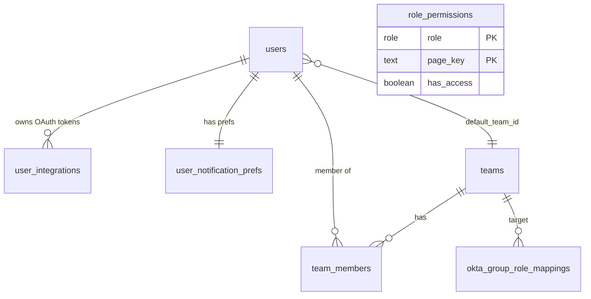
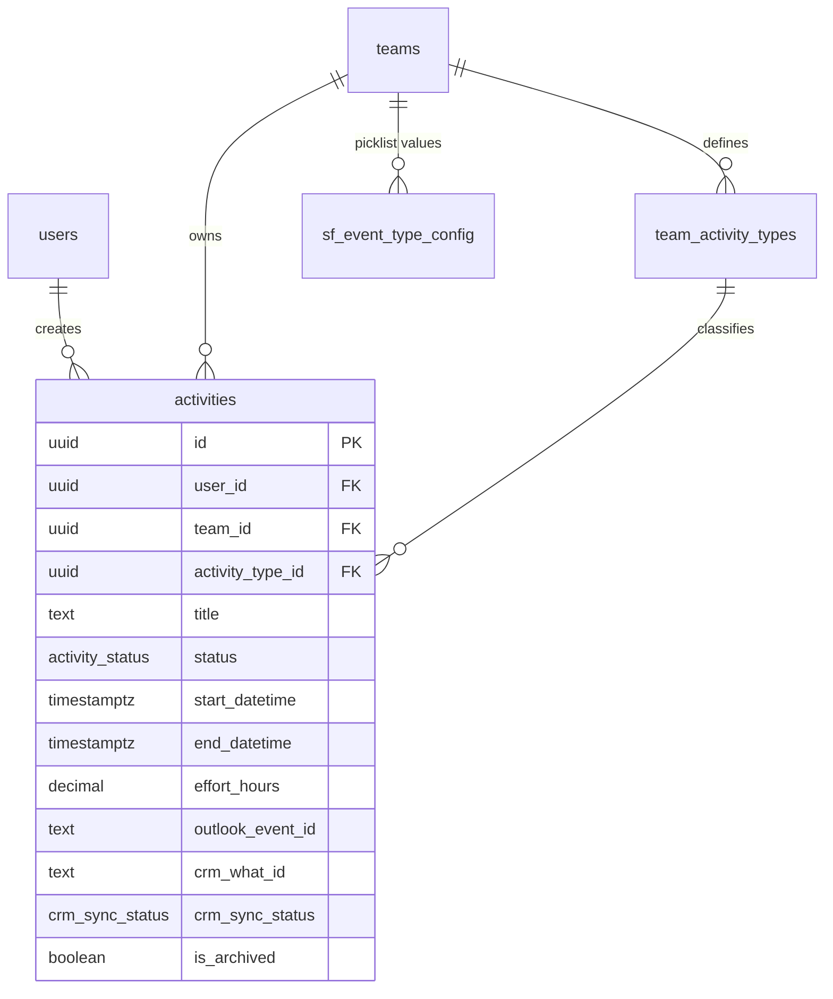
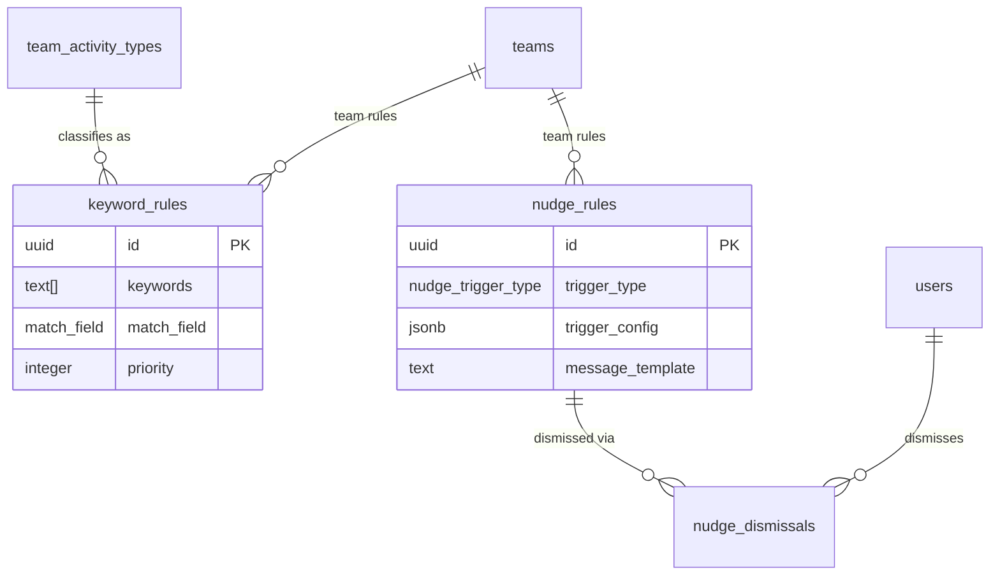
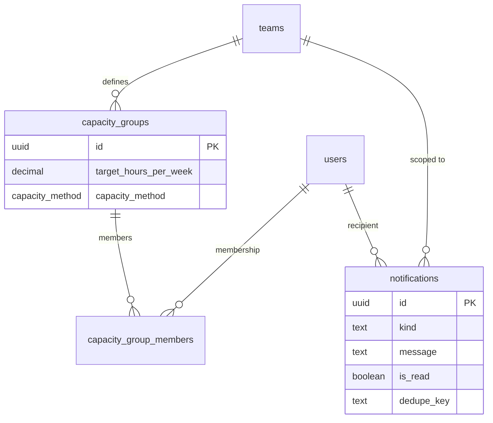

# ImpactIQ Database Schema

This document describes the Postgres schema that backs ImpactIQ. The source of truth is `drizzle/schema.ts`; the tables and enums below are regenerated from it via `node scripts/gen-db-schema.mjs`. Migrations live in `drizzle/migrations/` and are applied at server boot by `runMigrations()` in `src/server/db/index.ts`.

---

## Overview

- **Engine**: Postgres (containerized via `docker-compose.yml`; no Neon).
- **85 tables**, 750+ columns, 110+ foreign keys.
- **All primary keys are `uuid`** with `defaultRandom()` unless explicitly composite.
- **Soft delete** via `is_archived` boolean on `activities`. Other tables hard-delete with `ON DELETE CASCADE` where appropriate.
- **JSONB** columns: `nudge_rules.trigger_config` (shape varies by trigger type), `app_themes.colors` (Tailwind-style palette), `system_settings.value` (config-bucket pattern).
- **Currently at migration 0157.** Journal: `drizzle/migrations/meta/_journal.json`. Each new migration must add its entry to the journal — drizzle's migrator otherwise silently skips the SQL file (this has bitten the project twice now: the original PR #55 hotfix, and again when migrations 0137/0138 shipped without journal entries and were never applied until fixed in PR #454).
- **`password_history`** (migration 0142) holds the last few password hashes per `password`-auth user so `setUserPassword()` can reject reuse; `users.password_changed_at` drives the 90-day expiry check. `nudge_rules.name` (migration 0143) is an admin-editable display name distinguishing rules that share a `trigger_type`.
- **Recent additions (0145–0151)**: `activities.marketing_event_name` (0145); `activity_crm_tickets` — Support Ticket attachments, ImpactIQ-only, never part of the SF write-back (0146); `activities.crm_what_deleted`/`crm_who_deleted`/`crm_related_deleted`/`crm_disconnect_checked_at` — Activities Disconnected from SF (0147); `opp_review_dismissals` — the Closed Lost – Needs Review dashboard's per-Opportunity dismiss state (0148); the theme "palette" singleton was retired and promoted into a real `app_themes` row, so `app_themes` is now the single source of truth for every color/logo/email-header combination — see CLAUDE.md §14 (0149); `announcements` + `announcement_dismissals` — team broadcast messages surfaced in the header banner and notification bell (0150); `announcements.icon`/`icon_color_light`/`icon_color_dark` plus the matching pair on `notifications` — custom per-announcement header-banner icon (0151).
- **Recent additions (0152–0157)**: the fresh-install default theme renamed to "Default" (0152); default icons/colors on the ten seeded activity types (0153); `criteriaiq_evaluation_links` — a chosen CriteriaIQ project per CRM Evaluation record (0154); `hubspot_owners` — the HubSpot portal's owners, used to match ImpactIQ users by email (0155); `ai_providers`, `ai_feature_routes`, `ai_requests`, `ai_classification_cache` — the multi-provider AI Assistant (0156); `hubspot_owners.teams` — each owner's HubSpot teams, used as departments (0157).
- **CRM-neutral columns.** ImpactIQ talks to one CRM per install (Salesforce, HubSpot, or none — `system_settings.crm_provider`). Columns and tables that hold data for any CRM are named `crm_*` (`activities.crm_what_id`, `crm_record_id`, `crm_field_mappings`, `crm_users`, `crm_historical_*`, `activity_crm_tickets`, …; renamed from `sf_*` in v1.411–v1.413) and hold whichever CRM's ids the install uses; Salesforce-only tables (`sf_event_type_config`, `sf_user_names`, `sf_object_owner_cache`) keep `sf_*`; `crm_field_mappings.crm_object` holds the CRM's own object name (`Event`/`Opportunity` on Salesforce, `meetings`/`deals`/`0-970` on HubSpot). See `docs/crm.md`.

## Domain map

```
┌────────────────────────────────────────────────────────────┐
│                       Users / Auth                          │
│  users  ─┬─→  team_members ─→ teams                         │
│          ├─→  user_integrations (per-provider OAuth tokens) │
│          ├─→  user_notification_prefs                       │
│          └─→  okta_group_role_mappings (via teams.id)       │
│                                                              │
│       role_permissions (matrix — role × page_key)            │
└──┬─────────────────────────────────────────────────────────┘
   │
   ▼
┌────────────────────────────────────────────────────────────┐
│                          Teams                              │
│  teams ─┬─→ team_activity_types ─→ activities               │
│         ├─→ crm_field_mappings   (via junction)              │
│         ├─→ keyword_rules       (via junction)              │
│         ├─→ nudge_rules         (via junction)              │
│         ├─→ sf_event_type_config                            │
│         └─→ capacity_groups ─→ capacity_group_members → users
└────────────────────────────────────────────────────────────┘
```

Junction tables (`*_teams`) let one activity type / mapping / rule apply to multiple teams without duplicating rows. See [Junction tables](#junction-tables) below.

## Domain ER diagrams

### Users / Auth



### Activities



### AI / Rules



### Capacity & Notifications



## Junction tables

Four `*_teams` tables share a configuration resource across multiple teams without duplicating rows:

| Junction table | Composite PK | Configuration table |
|----------------|--------------|---------------------|
| `activity_type_teams` | `(activity_type_id, team_id)` | `team_activity_types` |
| `keyword_rule_teams` | `(keyword_rule_id, team_id)` | `keyword_rules` |
| `nudge_rule_teams` | `(nudge_rule_id, team_id)` | `nudge_rules` |
| `crm_field_mapping_teams` | `(crm_field_mapping_id, team_id)` | `crm_field_mappings` |

All four cascade-delete on either side. The pattern was introduced in migration `0005_team_assignment_junction_tables.sql` to let an admin reuse a keyword rule (e.g. matching "Demo") across the Sales Engineering and Channel teams without copy-paste.

## JSONB column shapes

### `nudge_rules.trigger_config`
The schema is keyed by `trigger_type`:
- `no_activity_days`: `{ "days": 5 }`
- `stage_no_type`: `{ "stage": "Eval", "type": "Eval Work", "days": 14 }`
- `type_no_followup`: `{ "fromType": "Discovery", "toType": "Demo", "days": 21 }`

Authoritative parsing lives in `src/server/services/nudge/engine.ts`.

### `app_themes.colors`
Tailwind-style palette object. Keys mirror the Tailwind class suffixes referenced in `src/client/components/ui/nav.tsx`:
```json
{
  "primary_light": "#2563eb",
  "primary_dark": "#3b82f6",
  "sidebar_bg_light": "#ffffff",
  "sidebar_bg_dark": "#111827",
  …
}
```

### `system_settings.value`
Free-shape config bucket keyed by `key` text. Current keys:
- `integration_config_okta`, `_salesforce`, `_microsoft`, `_azure`, `_smtp` — encrypted client_secret payloads.
- `auth_policy` — `{ requirePrecreatedUser: boolean }`.
- `okta_group_settings` — `{ groupClaimName, defaultRole, defaultTeamId, requestGroupsScope }`.
- `admin_sf_connection` — admin user's SF OAuth tokens (encrypted).
- `crm_provider` — `{ provider: 'salesforce' | 'hubspot' | 'none', dataProvider }`: the install's CRM and the CRM its existing links came from (drives the lock).
- `crm_features` — `{ campaignsEnabled, leadsEnabled }`: app-wide CRM feature switches.
- `hubspot_config` — HubSpot key (encrypted), portal id/name/domain, last access check.
- `evaluation_source` — `{ primary: 'crm' | 'criteriaiq' | 'off', dataSource, criteriaiqSecondary }`: where Projects come from.
- `criteriaiq_config` — CriteriaIQ base URL, API key (encrypted), private-network opt-in.
- `ai_settings` — `{ enabled, monthlyBudgetUsd, budgetAlertSentFor }` for the AI Assistant.
- `support_email`, `login_logo` — the help-icon address and the Login screen logo.
- `github_update_config` / `github_update_status` — App Updates (CLAUDE.md §14b): the pinned-branch owner/repo/PAT (encrypted) and the cached result of the last self-update check, respectively.
- `maintenance_window` — App Updates Phase 2 (CLAUDE.md §14b): `{ scheduledAt, message, status, createdBy, createdByEmail, createdAt, completedAt }` for the admin-scheduled self-restart countdown.

## Migration timeline

> Founding migrations only (0000–0013) — the schema has grown to 152 migrations since. For the full list, browse `drizzle/migrations/` directly; each `.sql` filename is self-describing.

| # | Migration | Summary |
|---|-----------|---------|
| 0000 | `initial_schema` | First cut: users, teams, team_members, activities, crm_field_mappings, keyword_rules, nudge_rules, capacity_groups, etc. |
| 0001 | `add_password_hash` | Local password login (Okta no longer mandatory at boot). |
| 0002 | `add_sf_instance_url` | Track which SF instance each user OAuth'd against. |
| 0003 | `add_team_icon_and_themes` | Per-team icon + `app_themes` table for branding. |
| 0004 | `app_admin_and_global_configs` | `users.is_app_admin`, nullable `team_id` on shared configs. |
| 0005 | `team_assignment_junction_tables` | The four `*_teams` junctions. |
| 0006 | `sf_mapping_teams_and_team_admin_role` | Adds `team_admin` to the `role` enum. |
| 0007 | `theme_logos_and_palette` | Per-theme light/dark logos + sidebar color variables. |
| 0008 | `must_change_password` | Forced password reset flag on `users`. |
| 0009 | `activity_fields_and_typical_duration` | `effort_hours` precision change + `sf_event_type_config.typical_duration_minutes`. |
| 0010 | `backfill_sf_mappings_and_notifications` | Seed SF mapping rows + `notifications` table. |
| 0011 | `notification_prefs` | `user_notification_prefs` for the email digest. |
| 0012 | `user_auth_and_default_team` | `users.default_team_id`, `is_default_admin`, `auth_method`. |
| 0013 | `okta_group_mappings_and_role_permissions` | `okta_group_role_mappings`, `role_permissions` matrix. |

## Tables (auto-generated)

> Re-run `node scripts/gen-db-schema.mjs` after `drizzle/schema.ts` changes. The script's regex parser misses two tables with multiline column literals (`team_activity_types`, `activities`) — see the `activities` ER diagram above for those. PRs welcome to harden the script.

<!-- BEGIN AUTOGEN -->

## Enums

### `role`

Values: `contributor`, `leader`, `team_admin`, `admin`

### `crm_object_type`

Values: `Event`, `Task`

### `activity_status`

Values: `draft`, `submitted`

### `crm_sync_status`

Values: `pending`, `synced`, `failed`

### `outlook_sync_status`

Values: `pending`, `synced`, `failed`

### `crm_what_type`

Values: `Opportunity`, `Account`, `Campaign`

### `meeting_reason_review_status`

Values: `ignore`, `will_watch`, `addressed`

### `match_field`

Values: `subject`, `body`, `both`

### `keyword_rule_action`

Values: `suggest_type`, `mark_non_activity`

### `nudge_trigger_type`

Values: `no_activity_days`, `stage_no_type`, `type_no_followup`, `weekly_hours_below_target`, `sf_sync_failed`, `opportunity_stale`, `product_gap`

### `capacity_method`

Values: `fixed_hours`, `self_declared`, `exception_adjusted`, `calendar_derived`

### `integration_provider`

Values: `salesforce`, `microsoft`

### `crm_alignment_role`

Values: `manager`, `owner`

### `flight_deck_link_type`

Values: `app_page`, `external_url`

### `announcement_target_type`

Values: `team`, `subteam`, `user`

## Tables

### `teams`

| Column | Type | Nullable | Default | FK | Notes |
|--------|------|----------|---------|----|----|
| `id` | `uuid` | ✓ | ✓ |  | PK |
| `name` | `text` | — | — |  |  |
| `slug` | `text` | — | — |  | unique |
| `description` | `text` | ✓ | — |  |  |
| `icon` | `text` | ✓ | — |  |  |
| `is_active` | `boolean` | — | ✓ |  |  |

### `subteams`

| Column | Type | Nullable | Default | FK | Notes |
|--------|------|----------|---------|----|----|
| `id` | `uuid` | ✓ | ✓ |  | PK |
| `team_id` | `uuid` | — | — | `teams.id` (on delete: cascade) |  |

### `subteam_users`

| Column | Type | Nullable | Default | FK | Notes |
|--------|------|----------|---------|----|----|
| `subteam_id` | `uuid` | — | — |  |  |
| `user_id` | `uuid` | — | — |  |  |
| `role` | `text` | — | — |  |  |

### `users`

| Column | Type | Nullable | Default | FK | Notes |
|--------|------|----------|---------|----|----|
| `id` | `uuid` | ✓ | ✓ |  | PK |
| `okta_id` | `text` | — | — |  | unique |
| `email` | `text` | — | — |  | unique |
| `display_name` | `text` | — | — |  |  |
| `last_name` | `text` | ✓ | — |  |  |
| `password_hash` | `text` | ✓ | — |  |  |
| `must_change_password` | `boolean` | — | ✓ |  |  |

### `password_history`

| Column | Type | Nullable | Default | FK | Notes |
|--------|------|----------|---------|----|----|
| `id` | `uuid` | ✓ | ✓ |  | PK |
| `user_id` | `uuid` | — | — | `users.id` (on delete: cascade) |  |

### `outlook_events`

| Column | Type | Nullable | Default | FK | Notes |
|--------|------|----------|---------|----|----|
| `id` | `text` | ✓ | — |  | PK |
| `user_id` | `uuid` | — | — | `users.id` (on delete: cascade) |  |

### `non_activity_events`

| Column | Type | Nullable | Default | FK | Notes |
|--------|------|----------|---------|----|----|
| `user_id` | `uuid` | — | — | `users.id` (on delete: cascade) |  |

### `team_members`

| Column | Type | Nullable | Default | FK | Notes |
|--------|------|----------|---------|----|----|
| `id` | `uuid` | ✓ | ✓ |  | PK |
| `team_id` | `uuid` | — | — | `teams.id` |  |
| `user_id` | `uuid` | — | — | `users.id` |  |
| `role` | `roleEnum` | — | — |  |  |

**Unique:** `teamId`, `userId`
**Unique:** `teamId`, `name`
**Unique:** `activityId`, `crmTicketId`

### `team_activity_type_subtypes`

| Column | Type | Nullable | Default | FK | Notes |
|--------|------|----------|---------|----|----|
| `id` | `uuid` | ✓ | ✓ |  | PK |
| `team_activity_type_id` | `uuid` | — | — | `teamActivityTypes.id` (on delete: cascade) |  |

### `activities`

| Column | Type | Nullable | Default | FK | Notes |
|--------|------|----------|---------|----|----|
| `id` | `uuid` | ✓ | ✓ |  | PK |
| `user_id` | `uuid` | — | — | `users.id` |  |
| `team_id` | `uuid` | — | — | `teams.id` |  |
| `title` | `text` | — | — |  |  |
| `activity_type_id` | `uuid` | — | — | `teamActivityTypes.id` (on delete: set null) |  |

### `activity_sync_audit`

| Column | Type | Nullable | Default | FK | Notes |
|--------|------|----------|---------|----|----|
| `id` | `uuid` | ✓ | ✓ |  | PK |
| `source` | `text` | — | ✓ |  |  |
| `activity_id` | `uuid` | ✓ | — | `activities.id` (on delete: cascade) |  |

### `sync_issue_resolutions`

| Column | Type | Nullable | Default | FK | Notes |
|--------|------|----------|---------|----|----|
| `id` | `uuid` | ✓ | ✓ |  | PK |
| `source` | `text` | — | — |  |  |
| `issue_key` | `text` | — | — |  |  |

### `crm_field_mappings`

| Column | Type | Nullable | Default | FK | Notes |
|--------|------|----------|---------|----|----|
| `id` | `uuid` | ✓ | ✓ |  | PK |
| `team_id` | `uuid` | — | — | `teams.id` |  |
| `app_field` | `text` | — | — |  |  |
| `crm_field_api` | `text` | — | — |  |  |
| `is_active` | `boolean` | — | ✓ |  |  |
| `updated_by` | `uuid` | ✓ | — | `users.id` |  |

### `attach_rate_fields`

| Column | Type | Nullable | Default | FK | Notes |
|--------|------|----------|---------|----|----|
| `id` | `uuid` | ✓ | ✓ |  | PK |
| `team_id` | `uuid` | — | ✓ | `teams.id` |  |
| `is_active` | `boolean` | — | ✓ |  |  |

### `crm_opportunity_coverage`

| Column | Type | Nullable | Default | FK | Notes |
|--------|------|----------|---------|----|----|
| `opp_id` | `text` | ✓ | — |  | PK |
| `created_date` | `date` | ✓ | — |  |  |
| `close_date` | `date` | ✓ | — |  |  |
| `stage_name` | `text` | ✓ | — |  |  |
| `forecast_category` | `text` | ✓ | — |  |  |
| `is_closed` | `boolean` | — | ✓ |  |  |
| `field_values` | `jsonb` | ✓ | — |  |  |

### `attach_rate_history`

| Column | Type | Nullable | Default | FK | Notes |
|--------|------|----------|---------|----|----|
| `team_id` | `uuid` | — | — | `teams.id` |  |
| `snapshot_date` | `date` | — | — |  |  |
| `total` | `integer` | — | ✓ |  |  |
| `attached` | `integer` | — | ✓ |  |  |

**Composite PK:** `teamId`, `snapshotDate`

### `sf_user_names`

| Column | Type | Nullable | Default | FK | Notes |
|--------|------|----------|---------|----|----|
| `sf_user_id` | `text` | ✓ | — |  | PK |
| `name` | `text` | ✓ | — |  |  |

### `crm_historical_import_runs`

| Column | Type | Nullable | Default | FK | Notes |
|--------|------|----------|---------|----|----|
| `id` | `uuid` | ✓ | ✓ |  | PK |

### `crm_historical_events`

| Column | Type | Nullable | Default | FK | Notes |
|--------|------|----------|---------|----|----|
| `crm_event_id` | `text` | ✓ | — |  | PK |
| `crm_type` | `text` | ✓ | — |  |  |

### `crm_historical_opportunities`

| Column | Type | Nullable | Default | FK | Notes |
|--------|------|----------|---------|----|----|
| `opp_id` | `text` | ✓ | — |  | PK |
| `opp_name` | `text` | ✓ | — |  |  |
| `account_id` | `text` | ✓ | — |  |  |
| `account_name` | `text` | ✓ | — |  |  |
| `stage_name` | `text` | ✓ | — |  |  |
| `forecast_category` | `text` | ✓ | — |  |  |
| `is_closed` | `boolean` | — | ✓ |  |  |
| `is_won` | `boolean` | — | ✓ |  |  |

### `crm_historical_accounts`

| Column | Type | Nullable | Default | FK | Notes |
|--------|------|----------|---------|----|----|
| `account_id` | `text` | ✓ | — |  | PK |
| `name` | `text` | ✓ | — |  |  |
| `owner_id` | `text` | ✓ | — |  |  |
| `industry` | `text` | ✓ | — |  |  |

### `crm_historical_type_map`

| Column | Type | Nullable | Default | FK | Notes |
|--------|------|----------|---------|----|----|
| `team_id` | `uuid` | — | — | `teams.id` (on delete: cascade) |  |

### `crm_historical_exclusions`

| Column | Type | Nullable | Default | FK | Notes |
|--------|------|----------|---------|----|----|
| `kind` | `text` | — | — |  |  |
| `crm_user_id` | `text` | — | — |  |  |
| `label` | `text` | ✓ | — |  |  |
| `note` | `text` | ✓ | — |  |  |
| `is_active` | `boolean` | — | ✓ |  |  |
| `created_by` | `uuid` | ✓ | — | `users.id` (on delete: set null) |  |

### `crm_historical_backfill_state`

| Column | Type | Nullable | Default | FK | Notes |
|--------|------|----------|---------|----|----|
| `key` | `text` | ✓ | — |  | PK |

### `sf_event_type_config`

| Column | Type | Nullable | Default | FK | Notes |
|--------|------|----------|---------|----|----|
| `id` | `uuid` | ✓ | ✓ |  | PK |
| `team_id` | `uuid` | — | — | `teams.id` |  |
| `sf_picklist_value` | `text` | — | — |  |  |
| `is_active` | `boolean` | — | ✓ |  |  |
| `fallback_value` | `text` | ✓ | — |  |  |
| `typical_duration_minutes` | `integer` | ✓ | — |  |  |

### `keyword_rules`

| Column | Type | Nullable | Default | FK | Notes |
|--------|------|----------|---------|----|----|
| `id` | `uuid` | ✓ | ✓ |  | PK |
| `team_id` | `uuid` | ✓ | — | `teams.id` |  |
| `keywords` | `text` | — | — | `teamActivityTypes.id` |  |
| `match_field` | `matchFieldEnum` | — | — |  |  |
| `priority` | `integer` | — | — |  |  |
| `is_active` | `boolean` | — | ✓ |  |  |
| `action` | `keywordRuleActionEnum` | — | ✓ |  |  |

### `nudge_rules`

| Column | Type | Nullable | Default | FK | Notes |
|--------|------|----------|---------|----|----|
| `id` | `uuid` | ✓ | ✓ |  | PK |
| `team_id` | `uuid` | — | — | `teams.id` |  |
| `trigger_type` | `nudgeTriggerTypeEnum` | — | — |  |  |
| `trigger_config` | `jsonb` | — | — |  |  |
| `message_template` | `text` | — | — |  |  |
| `is_active` | `boolean` | — | ✓ |  |  |
| `icon` | `text` | — | ✓ |  |  |

### `nudge_rule_translations`

| Column | Type | Nullable | Default | FK | Notes |
|--------|------|----------|---------|----|----|
| `id` | `uuid` | ✓ | ✓ |  | PK |
| `nudge_rule_id` | `uuid` | — | — | `nudgeRules.id` (on delete: cascade) |  |

### `nudge_events`

| Column | Type | Nullable | Default | FK | Notes |
|--------|------|----------|---------|----|----|
| `id` | `uuid` | ✓ | ✓ |  | PK |
| `user_id` | `uuid` | — | — | `users.id` (on delete: cascade) |  |

### `nudge_dismissals`

| Column | Type | Nullable | Default | FK | Notes |
|--------|------|----------|---------|----|----|
| `id` | `uuid` | ✓ | ✓ |  | PK |
| `user_id` | `uuid` | — | — | `users.id` |  |
| `nudge_rule_id` | `uuid` | — | — | `nudgeRules.id` |  |

### `opp_review_dismissals`

| Column | Type | Nullable | Default | FK | Notes |
|--------|------|----------|---------|----|----|
| `id` | `uuid` | ✓ | ✓ |  | PK |
| `team_id` | `uuid` | — | — | `teams.id` |  |
| `crm_opp_id` | `text` | — | — |  |  |
| `crm_opp_name` | `text` | — | — |  |  |
| `dismissed_by` | `uuid` | — | — | `users.id` |  |

### `capacity_groups`

| Column | Type | Nullable | Default | FK | Notes |
|--------|------|----------|---------|----|----|
| `id` | `uuid` | ✓ | ✓ |  | PK |
| `name` | `text` | — | — |  |  |

### `capacity_group_teams`

| Column | Type | Nullable | Default | FK | Notes |
|--------|------|----------|---------|----|----|
| `group_id` | `uuid` | — | — | `capacityGroups.id` (on delete: cascade) |  |

### `capacity_user_overrides`

| Column | Type | Nullable | Default | FK | Notes |
|--------|------|----------|---------|----|----|
| `id` | `uuid` | ✓ | ✓ |  | PK |
| `user_id` | `uuid` | — | — | `users.id` (on delete: cascade) |  |

### `cost_groups`

| Column | Type | Nullable | Default | FK | Notes |
|--------|------|----------|---------|----|----|
| `id` | `uuid` | ✓ | ✓ |  | PK |
| `name` | `text` | — | — |  |  |

### `cost_group_teams`

| Column | Type | Nullable | Default | FK | Notes |
|--------|------|----------|---------|----|----|
| `group_id` | `uuid` | — | — | `costGroups.id` (on delete: cascade) |  |

### `cost_user_overrides`

| Column | Type | Nullable | Default | FK | Notes |
|--------|------|----------|---------|----|----|
| `id` | `uuid` | ✓ | ✓ |  | PK |
| `user_id` | `uuid` | — | — | `users.id` (on delete: cascade) |  |

### `fx_rates`

| Column | Type | Nullable | Default | FK | Notes |
|--------|------|----------|---------|----|----|
| `id` | `uuid` | ✓ | ✓ |  | PK |
| `currency` | `text` | — | — |  |  |

### `user_integrations`

| Column | Type | Nullable | Default | FK | Notes |
|--------|------|----------|---------|----|----|
| `id` | `uuid` | ✓ | ✓ |  | PK |
| `user_id` | `uuid` | — | — | `users.id` |  |
| `provider` | `integrationProviderEnum` | — | — |  |  |
| `access_token_encrypted` | `text` | ✓ | — |  |  |
| `refresh_token_encrypted` | `text` | ✓ | — |  |  |

### `activity_type_teams`

| Column | Type | Nullable | Default | FK | Notes |
|--------|------|----------|---------|----|----|
| `activity_type_id` | `uuid` | — | — | `teamActivityTypes.id` (on delete: cascade) |  |

### `keyword_rule_teams`

| Column | Type | Nullable | Default | FK | Notes |
|--------|------|----------|---------|----|----|
| `keyword_rule_id` | `uuid` | — | — | `keywordRules.id` (on delete: cascade) |  |

### `nudge_rule_teams`

| Column | Type | Nullable | Default | FK | Notes |
|--------|------|----------|---------|----|----|
| `nudge_rule_id` | `uuid` | — | — | `nudgeRules.id` (on delete: cascade) |  |

### `crm_field_mapping_teams`

| Column | Type | Nullable | Default | FK | Notes |
|--------|------|----------|---------|----|----|
| `crm_field_mapping_id` | `uuid` | — | — | `crmFieldMappings.id` (on delete: cascade) |  |

### `app_themes`

| Column | Type | Nullable | Default | FK | Notes |
|--------|------|----------|---------|----|----|
| `id` | `uuid` | ✓ | ✓ |  | PK |
| `name` | `text` | — | — |  |  |
| `colors` | `jsonb` | — | — |  |  |
| `is_active` | `boolean` | — | ✓ |  |  |
| `logo_light` | `text` | ✓ | — |  |  |
| `logo_dark` | `text` | ✓ | — |  |  |
| `email_bottom_bar_color` | `text` | ✓ | — |  |  |
| `email_footer_left_text` | `text` | ✓ | — |  |  |
| `email_header_logo_variant` | `text` | ✓ | — |  |  |

### `system_settings`

| Column | Type | Nullable | Default | FK | Notes |
|--------|------|----------|---------|----|----|
| `key` | `text` | ✓ | — |  | PK |
| `value` | `jsonb` | — | — |  |  |

### `criteriaiq_evaluation_links`

| Column | Type | Nullable | Default | FK | Notes |
|--------|------|----------|---------|----|----|
| `crm_record_id` | `text` | ✓ | — |  | PK |
| `criteriaiq_project_id` | `integer` | — | — |  |  |
| `linked_by` | `uuid` | ✓ | — | `users.id` (on delete: set null) |  |

### `hubspot_owners`

| Column | Type | Nullable | Default | FK | Notes |
|--------|------|----------|---------|----|----|
| `id` | `text` | ✓ | — |  | PK |
| `hubspot_user_id` | `text` | ✓ | — |  |  |
| `email` | `text` | ✓ | — |  |  |
| `first_name` | `text` | ✓ | — |  |  |
| `last_name` | `text` | ✓ | — |  |  |
| `archived` | `boolean` | — | ✓ |  |  |

### `ai_providers`

| Column | Type | Nullable | Default | FK | Notes |
|--------|------|----------|---------|----|----|
| `id` | `uuid` | ✓ | ✓ |  | PK |
| `kind` | `text` | — | — |  |  |
| `name` | `text` | — | — |  |  |
| `is_active` | `boolean` | — | ✓ |  |  |
| `is_default` | `boolean` | — | ✓ |  |  |
| `model` | `text` | — | — |  |  |
| `secret_encrypted` | `text` | ✓ | — |  |  |
| `endpoint` | `text` | ✓ | — |  |  |
| `api_version` | `text` | ✓ | — |  |  |
| `allowed_custom_host` | `text` | ✓ | — |  |  |
| `region` | `text` | ✓ | — |  |  |
| `access_key_id` | `text` | ✓ | — |  |  |
| `resource` | `text` | ✓ | — |  |  |
| `organization` | `text` | ✓ | — |  |  |

### `ai_feature_routes`

| Column | Type | Nullable | Default | FK | Notes |
|--------|------|----------|---------|----|----|
| `feature` | `text` | ✓ | — |  | PK |
| `provider_id` | `uuid` | — | — | `aiProviders.id` (on delete: cascade) |  |

### `ai_requests`

| Column | Type | Nullable | Default | FK | Notes |
|--------|------|----------|---------|----|----|
| `id` | `uuid` | ✓ | ✓ |  | PK |
| `feature` | `text` | — | — |  |  |
| `provider_id` | `uuid` | ✓ | — | `aiProviders.id` (on delete: set null) |  |

### `ai_classification_cache`

| Column | Type | Nullable | Default | FK | Notes |
|--------|------|----------|---------|----|----|
| `id` | `uuid` | ✓ | ✓ |  | PK |
| `team_id` | `uuid` | — | — | `teams.id` (on delete: cascade) |  |

### `user_notification_prefs`

| Column | Type | Nullable | Default | FK | Notes |
|--------|------|----------|---------|----|----|
| `user_id` | `uuid` | ✓ | — | `users.id` (on delete: cascade) | PK |

### `dashboard_presets`

| Column | Type | Nullable | Default | FK | Notes |
|--------|------|----------|---------|----|----|
| `id` | `uuid` | ✓ | ✓ |  | PK |
| `user_id` | `uuid` | — | — | `users.id` (on delete: cascade) |  |

### `notifications`

| Column | Type | Nullable | Default | FK | Notes |
|--------|------|----------|---------|----|----|
| `id` | `uuid` | ✓ | ✓ |  | PK |
| `user_id` | `uuid` | — | — | `users.id` (on delete: cascade) |  |

### `okta_group_role_mappings`

| Column | Type | Nullable | Default | FK | Notes |
|--------|------|----------|---------|----|----|
| `id` | `uuid` | ✓ | ✓ |  | PK |
| `okta_group` | `text` | — | — |  |  |
| `role` | `roleEnum` | — | — |  |  |
| `team_id` | `uuid` | ✓ | — | `teams.id` (on delete: cascade) |  |

### `role_permissions`

| Column | Type | Nullable | Default | FK | Notes |
|--------|------|----------|---------|----|----|
| `role` | `roleEnum` | — | — |  |  |
| `page_key` | `text` | — | — |  |  |
| `has_access` | `boolean` | — | ✓ |  |  |

**Composite PK:** `role`, `pageKey`

**Unique:** `calendarId`, `date`

### `user_holiday_calendars`

| Column | Type | Nullable | Default | FK | Notes |
|--------|------|----------|---------|----|----|
| `user_id` | `uuid` | — | — | `users.id` (on delete: cascade) |  |

### `user_pto_days`

| Column | Type | Nullable | Default | FK | Notes |
|--------|------|----------|---------|----|----|
| `user_id` | `uuid` | — | — | `users.id` (on delete: cascade) |  |

### `team_holiday_calendars`

| Column | Type | Nullable | Default | FK | Notes |
|--------|------|----------|---------|----|----|
| `team_id` | `uuid` | — | — | `teams.id` (on delete: cascade) |  |

### `products`

| Column | Type | Nullable | Default | FK | Notes |
|--------|------|----------|---------|----|----|
| `id` | `uuid` | ✓ | ✓ |  | PK |
| `name` | `text` | — | — |  |  |
| `space` | `text` | ✓ | — |  |  |
| `abbreviation` | `text` | ✓ | — |  |  |
| `is_active` | `boolean` | — | ✓ |  |  |

### `product_teams`

| Column | Type | Nullable | Default | FK | Notes |
|--------|------|----------|---------|----|----|
| `product_id` | `uuid` | — | — | `products.id` (on delete: cascade) |  |

### `activity_products`

| Column | Type | Nullable | Default | FK | Notes |
|--------|------|----------|---------|----|----|
| `activity_id` | `uuid` | — | — | `activities.id` (on delete: cascade) |  |

### `audit_events`

| Column | Type | Nullable | Default | FK | Notes |
|--------|------|----------|---------|----|----|
| `id` | `uuid` | ✓ | ✓ |  | PK |
| `actor_user_id` | `uuid` | ✓ | — | `users.id` (on delete: set null) |  |

### `api_keys`

| Column | Type | Nullable | Default | FK | Notes |
|--------|------|----------|---------|----|----|
| `id` | `uuid` | ✓ | ✓ |  | PK |
| `user_id` | `uuid` | — | — | `users.id` (on delete: cascade) |  |

### `mcp_tool_calls`

| Column | Type | Nullable | Default | FK | Notes |
|--------|------|----------|---------|----|----|
| `id` | `uuid` | ✓ | ✓ |  | PK |
| `api_key_id` | `uuid` | ✓ | — | `apiKeys.id` (on delete: set null) |  |

### `activity_templates`

| Column | Type | Nullable | Default | FK | Notes |
|--------|------|----------|---------|----|----|
| `id` | `uuid` | ✓ | ✓ |  | PK |
| `user_id` | `uuid` | — | — | `users.id` (on delete: cascade) |  |

### `crm_users`

| Column | Type | Nullable | Default | FK | Notes |
|--------|------|----------|---------|----|----|
| `id` | `text` | ✓ | — |  | PK |
| `name` | `text` | — | — |  |  |
| `email` | `text` | ✓ | — |  |  |
| `manager_id` | `text` | ✓ | — |  |  |
| `title` | `text` | ✓ | — |  |  |
| `is_active` | `boolean` | — | ✓ |  |  |

### `crm_user_alignments`

| Column | Type | Nullable | Default | FK | Notes |
|--------|------|----------|---------|----|----|
| `user_id` | `uuid` | — | — | `users.id` (on delete: cascade) |  |

### `sf_object_owner_cache`

| Column | Type | Nullable | Default | FK | Notes |
|--------|------|----------|---------|----|----|
| `sf_id` | `text` | ✓ | — |  | PK |
| `object_type` | `text` | — | — |  |  |
| `account_id` | `text` | ✓ | — |  |  |
| `account_name` | `text` | ✓ | — |  |  |
| `owner_id` | `text` | ✓ | — |  |  |
| `owner_name` | `text` | ✓ | — |  |  |

### `sessions`

| Column | Type | Nullable | Default | FK | Notes |
|--------|------|----------|---------|----|----|
| `id` | `uuid` | ✓ | ✓ |  | PK |
| `user_id` | `uuid` | — | — | `users.id` (on delete: cascade) |  |

### `login_events`

| Column | Type | Nullable | Default | FK | Notes |
|--------|------|----------|---------|----|----|
| `id` | `uuid` | ✓ | ✓ | `users.id` (on delete: cascade) | PK |

### `work_week_change_requests`

| Column | Type | Nullable | Default | FK | Notes |
|--------|------|----------|---------|----|----|
| `id` | `uuid` | ✓ | ✓ |  | PK |
| `user_id` | `uuid` | — | — | `users.id` (on delete: cascade) |  |

### `activity_notes`

| Column | Type | Nullable | Default | FK | Notes |
|--------|------|----------|---------|----|----|
| `id` | `uuid` | ✓ | ✓ |  | PK |
| `activity_id` | `uuid` | — | — | `activities.id` (on delete: cascade) |  |

### `activity_note_pushes`

| Column | Type | Nullable | Default | FK | Notes |
|--------|------|----------|---------|----|----|
| `id` | `uuid` | ✓ | ✓ |  | PK |
| `activity_note_id` | `uuid` | — | — | `activityNotes.id` (on delete: cascade) |  |

### `email_rules`

| Column | Type | Nullable | Default | FK | Notes |
|--------|------|----------|---------|----|----|
| `key` | `text` | ✓ | — |  | PK |
| `name` | `text` | — | — |  |  |
| `description` | `text` | ✓ | — |  |  |
| `is_active` | `boolean` | — | ✓ |  |  |
| `subject_template` | `text` | ✓ | — |  |  |
| `body_template` | `text` | ✓ | — |  |  |

### `password_reset_tokens`

| Column | Type | Nullable | Default | FK | Notes |
|--------|------|----------|---------|----|----|
| `id` | `uuid` | ✓ | ✓ |  | PK |
| `user_id` | `uuid` | — | — | `users.id` (on delete: cascade) |  |

### `crm_snapshot_state`

| Column | Type | Nullable | Default | FK | Notes |
|--------|------|----------|---------|----|----|
| `key` | `text` | ✓ | — |  | PK |

### `crm_lead_account_link`

| Column | Type | Nullable | Default | FK | Notes |
|--------|------|----------|---------|----|----|
| `lead_id` | `text` | ✓ | — |  | PK |
| `account_id` | `text` | ✓ | — |  |  |

### `job_runs`

| Column | Type | Nullable | Default | FK | Notes |
|--------|------|----------|---------|----|----|
| `id` | `uuid` | ✓ | ✓ |  | PK |
| `job_key` | `text` | — | — |  |  |

### `job_config`

| Column | Type | Nullable | Default | FK | Notes |
|--------|------|----------|---------|----|----|
| `job_key` | `text` | ✓ | — |  | PK |
| `notify_on_error` | `boolean` | — | ✓ |  |  |

### `flight_deck_items`

| Column | Type | Nullable | Default | FK | Notes |
|--------|------|----------|---------|----|----|
| `id` | `uuid` | ✓ | ✓ |  | PK |
| `team_id` | `uuid` | — | — | `teams.id` (on delete: cascade) |  |

### `flight_deck_item_translations`

| Column | Type | Nullable | Default | FK | Notes |
|--------|------|----------|---------|----|----|
| `id` | `uuid` | ✓ | ✓ |  | PK |
| `item_id` | `uuid` | — | — | `flightDeckItems.id` (on delete: cascade) |  |

### `flight_deck_completions`

| Column | Type | Nullable | Default | FK | Notes |
|--------|------|----------|---------|----|----|
| `user_id` | `uuid` | — | — | `users.id` (on delete: cascade) |  |

### `announcements`

| Column | Type | Nullable | Default | FK | Notes |
|--------|------|----------|---------|----|----|
| `id` | `uuid` | ✓ | ✓ |  | PK |
| `team_id` | `uuid` | — | — | `teams.id` (on delete: cascade) |  |

### `announcement_dismissals`

| Column | Type | Nullable | Default | FK | Notes |
|--------|------|----------|---------|----|----|
| `id` | `uuid` | ✓ | ✓ |  | PK |
| `user_id` | `uuid` | — | — | `users.id` (on delete: cascade) |  |

<!-- END AUTOGEN -->
